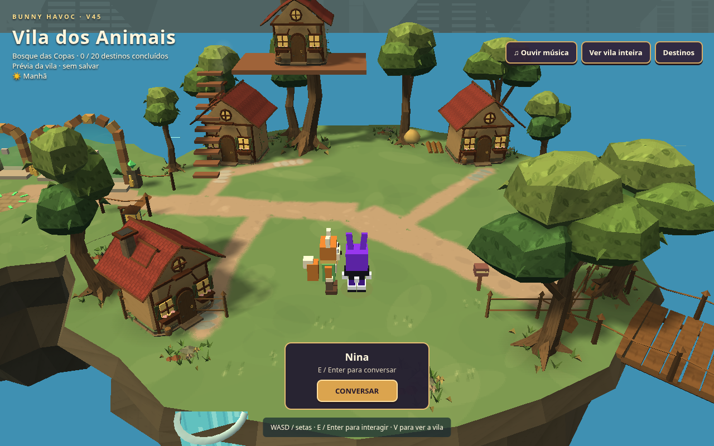
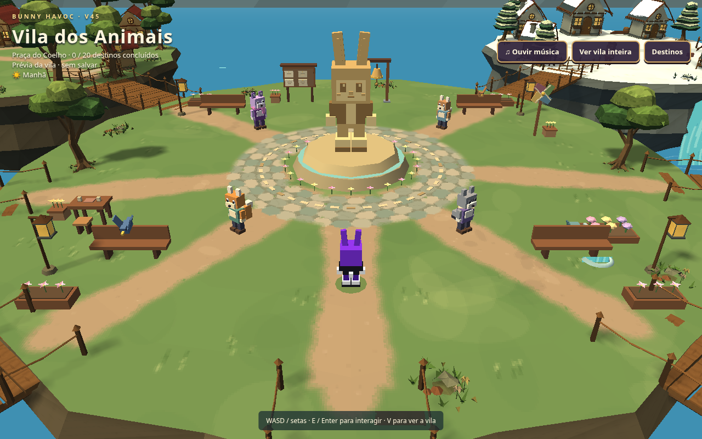
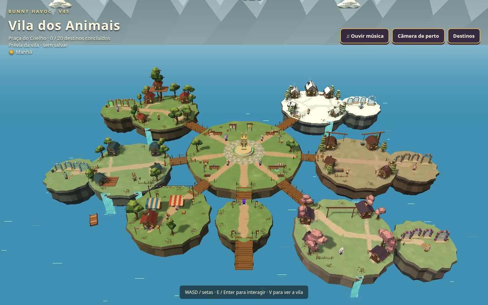

# Bunny Havoc — caminhos da Vila dos Animais

[Baixar o jogo completo](Bunny_Havoc_V45_Modular.zip)

Revisão das trilhas após o refinamento do cenário: terra batida mais estreita,
larguras variáveis, bordas com grama e junções contínuas. Vielas das casas se
ligam à passagem mais próxima, evitando a convergência em estrela. Pedras
ficam agrupadas nas soleiras e formam pavimento contínuo na praça. Foram
retirados os 25 ladrilhos isolados da entrada.

Terreno, alturas, colisões, personagens, casas, portais, controles, músicas,
saves e funcionalidades preservados. Sem novas malhas, texturas de GPU ou
partículas. A revisão altera a pintura dos caminhos e remove decoração antiga.
Passaram duas suítes de cenário (layout, geometria, orçamento e acessos),
build/typecheck determinístico e teste do ZIP extraído por HTTP com portal,
fase, ataque e música. Fases e combate não foram editados.

Extraia o ZIP inteiro, mantendo as pastas. No Windows: Windows + R, cmd /d,
e execute (ajuste o diretório se necessário):

```bat
py -m http.server 8765 --bind 127.0.0.1 --directory "C:\Users\User\Downloads\Bunny_Havoc_V45_Modular"
```

Abra http://127.0.0.1:8765/ e mantenha o terminal aberto. Após substituir os
arquivos anteriores, use Ctrl+F5. Manter origem e navegador mantém os saves.
Three.js r128 e recursos locais incluídos. Nomes V45 preservados.
As capturas usam qualidade alta sem filtro PSX para inspeção dos materiais.





Branch somente de artefatos. Entregas anteriores preservadas; sem publicação
em Pages ou alteração do main. SHA-256 do ZIP: 68e3056f75b7bd7ee41f695117d7a2fad160440db0ef3d289619c7cf6783a12e
