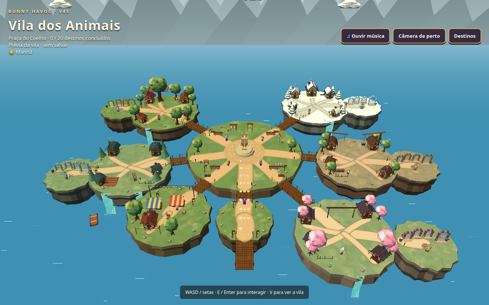
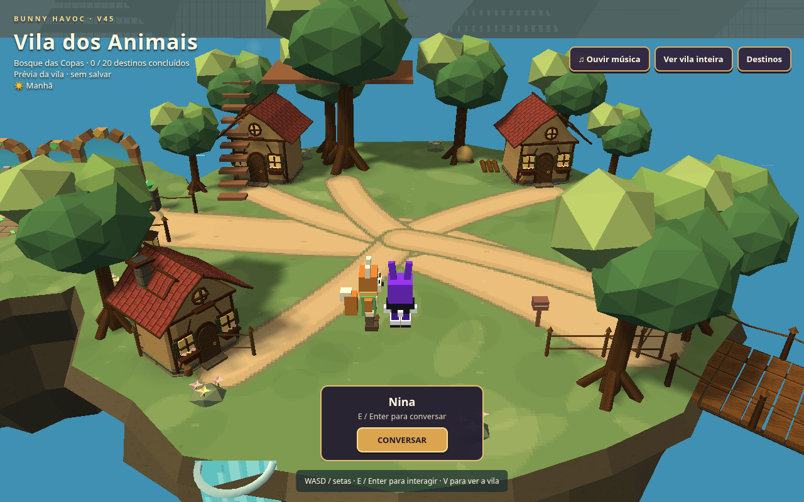
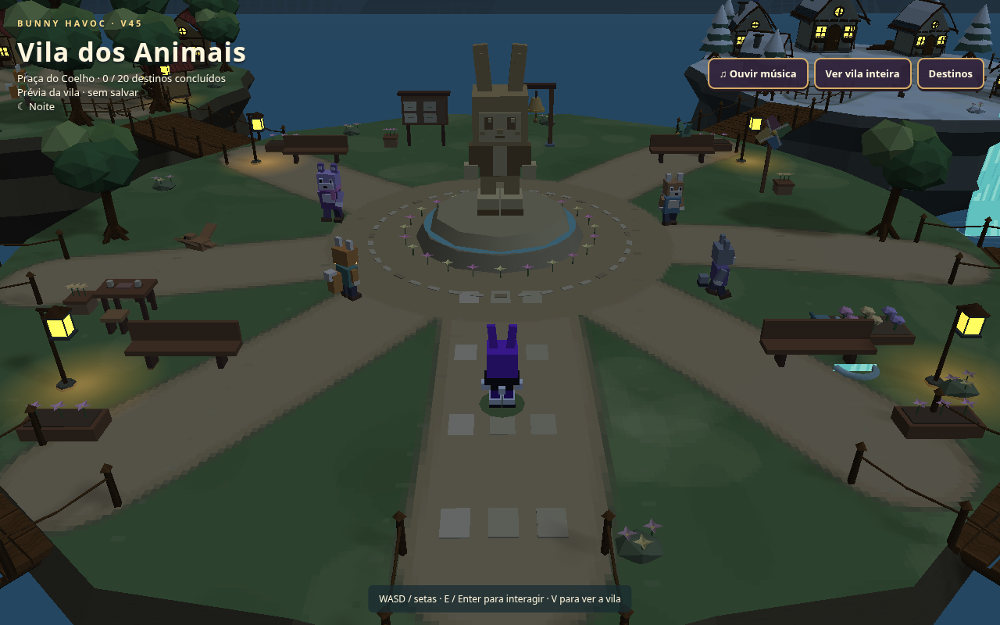

# Bunny Havoc — Vila dos Animais: overhaul visual

[Baixar o jogo completo](Bunny_Havoc_V45_Modular.zip)

Modelagem refeita de casas e telhados dos cinco bairros, materiais pintados,
penhascos e caminhos, vegetação, pontes, mercado, lanternas, monumento,
cachoeiras e ambientação. Moradores preservados com utensílios e gestos,
partículas discretas e sons ambientes locais. Sem placas de nomes das fases.

Personagens, duas fases, combate, cutscenes, vinte portais, confirmação dos
Meowlin, progresso/saves e ciclo dia/noite foram preservados. As lojas continuam
com ambientação e atendentes; compras/upgrades seguem pendentes de definição.
Three.js r128 continua incluído localmente. Build, tipos e 18 suítes passaram;
o ZIP extraído foi testado no navegador pelo servidor HTTP do Python.

Extraia o ZIP inteiro, mantendo assets, scenes, runtime e vendor. No Windows,
abra Windows + R, execute cmd /d e use (ajuste o caminho se necessário):

```bat
py -m http.server 8765 --bind 127.0.0.1 --directory "C:\Users\User\Downloads\Bunny_Havoc_V45_Modular"
```

Abra http://127.0.0.1:8765/ e mantenha o terminal aberto. Após substituir o
pacote anterior, use Ctrl+F5. Manter protocolo, host, porta e navegador preserva
a origem dos saves. Em outros sistemas, também funciona qualquer servidor HTTP
estático. O ZIP mantém os nomes V45 por compatibilidade.





Este branch contém somente artefatos de entrega. Os backups e entregas
anteriores permanecem preservados. A migração modular continua gradual.
SHA-256 do ZIP: 732b9e4de5f7ae6f372786d4e1eb6450fc5ded93afb5474e16bfc1588c87d651
