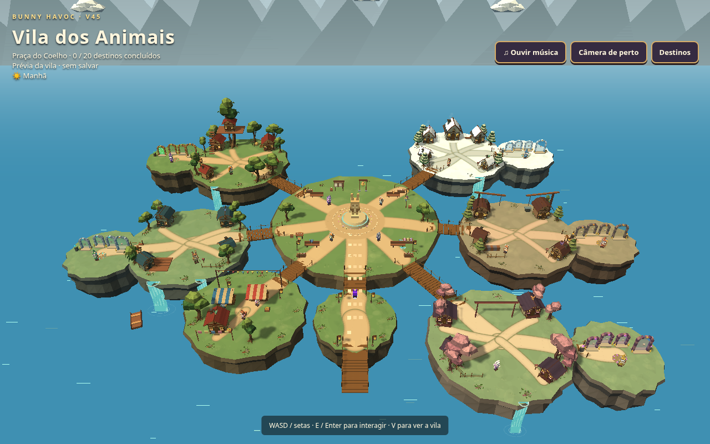
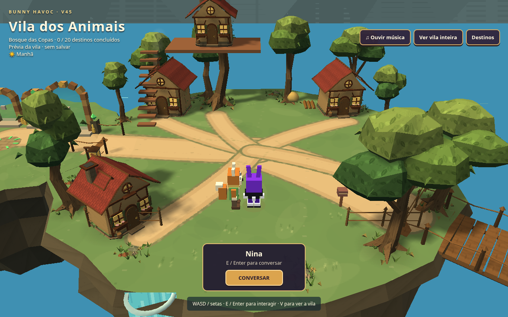
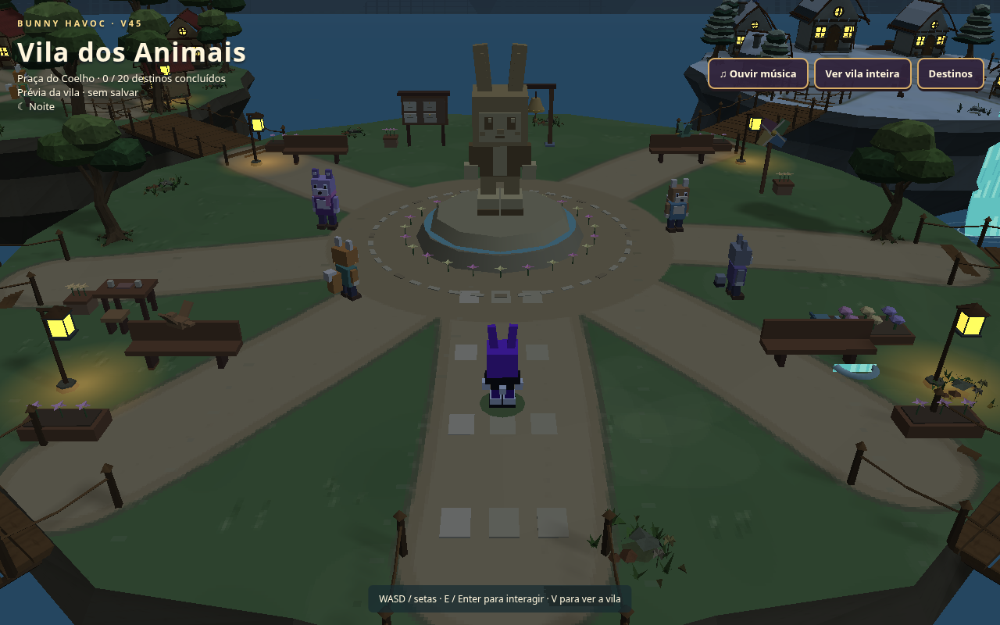

# Bunny Havoc — Vila dos Animais: refinamento de cenário

[Baixar o jogo completo](Bunny_Havoc_V45_Modular.zip)

Árvores com troncos curvos, raízes afiladas, galhos e copas recortadas em
camadas; oito tipos de árvore com silhuetas próprias. Texturas pintadas de
casca, folhas, madeira, telhas e rochas. Canteiros de grama, flores, cogumelos
e folhas caídas substituem os grupos simples das bordas. Trepadeiras e
arbustos integram as casas; terreno com relevo baixo, desgaste e contato.

Personagens, controles, posições das casas/árvores, pontes, portais, moradores,
ciclo dia/noite, fases, combate, cutscenes, músicas e saves preservados.
Não há partículas adicionais nem mudanças nas funcionalidades das lojas.
Materiais compartilhados e geometria otimizada mantêm o orçamento anterior.
Build, tipos e 19 suítes passaram; o ZIP extraído foi testado pelo servidor
HTTP do Python com vila, confirmação do Meowlin, fase, ataque e música real.

Extraia o ZIP inteiro, mantendo todas as pastas. No Windows, abra Windows + R,
execute cmd /d e use (ajuste o caminho se necessário):

```bat
py -m http.server 8765 --bind 127.0.0.1 --directory "C:\Users\User\Downloads\Bunny_Havoc_V45_Modular"
```

Abra http://127.0.0.1:8765/ e mantenha o terminal aberto. Após substituir o
pacote anterior, use Ctrl+F5. Manter protocolo, host, porta e navegador preserva
a origem dos saves. Three.js r128, músicas e scripts estão incluídos localmente.
O ZIP mantém os nomes V45 por compatibilidade. As capturas abaixo usam qualidade
alta e filtro PSX desligado para permitir avaliar os modelos; as opções do jogo
continuam disponíveis.





Este branch contém somente artefatos de entrega. As entregas anteriores e
backups permanecem preservados. A avaliação artística cabe ao usuário.
SHA-256 do ZIP: df7889ed2edc46f2540ca5d9e642df97dc772b7b402bf6df61e1b6cd4aa4a3f3
