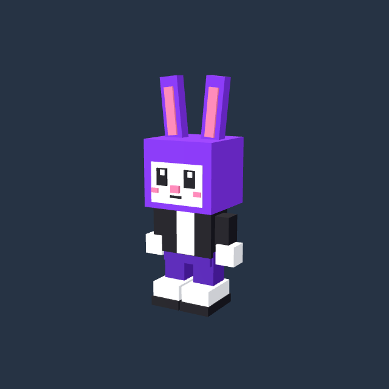

# Bunnyck original — primeiro modelo para Godot

[Baixar ZIP](Bunnyck_Godot_Modelo_Original.zip) · [Baixar GLB diretamente](bunnyck.glb)

Esta é somente a geometria do Bunnyck do jogo atual, em pose neutra, com
28 malhas, 336 triângulos, cinco cores e pivôs de braços/pernas/orelhas/cauda.
A escala e as proporções originais foram preservadas. Sem movimento, colisão
ou animações prontas. O jogo Three.js não foi alterado.

## Importar na cena que você criou

1. No Godot, pare o teste com F8.
2. Baixe e extraia o ZIP. Copie a pasta Bunnyck para a pasta do seu projeto,
   junto de project.godot e teste_fase_1.tscn. Pelo painel Arquivos do Godot,
   botão direito em res:// abre a opção de mostrar a pasta no gerenciador.
3. Volte ao editor e espere a importação automática.
4. Arraste res://Bunnyck/bunnyck.glb sobre TesteFase1, na árvore da cena.
5. Selecione o modelo adicionado e ajuste Transform > Position para (0,0,0).
   Mantenha sua escala importada. Limpe o filtro do Inspetor se necessário.
6. Ctrl+S para salvar e F6 para executar a cena.

As solas ficam em zero; o chão do teste tem superfície em Y=0. A câmera do
usuário em (0,7,10), rotação (-30,0,0), deve enxergar a frente do modelo (+Z).

O GLB foi reaberto e comparado com a extração: vértices, pivôs e cores iguais,
sem recursos externos. Este arquivo ainda precisa ser conferido pelo usuário
na importação do Godot 4.7.2; não houve execução de Godot neste ambiente.
A prévia abaixo é de Three.js, não uma captura do Godot.

A próxima etapa é conferir a importação; depois criar corpo físico e controles
em GDScript. As fases, combate, animações e os demais sistemas serão migrados
gradualmente. A meta do usuário é Windows e navegador.

Branch somente de artefatos; não substitui o projeto Godot do usuário nem
publica alterações no main. SHA-256 do ZIP: 949906e22fbb655703854d1126276eb075a3c4ce6ae88216870a921901309d8e
