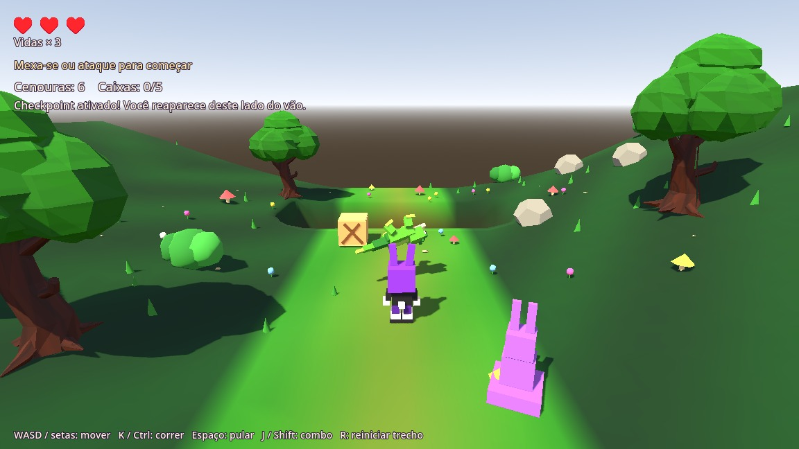

# Bunny Havoc — encontro com lagarto

[Baixar a pasta completa atualizada](Bunny_Havoc_Godot_Lagarto.zip)

Extraia em uma pasta nova, importe `project.godot` e pressione F5.
Na janela do jogo, selecione Entrada. Não precisa montar cenas ou anexar scripts.

Depois do segundo checkpoint, enfrente o lagarto original: dois pontos de
vida, preparação de bote, perseguição, recuo real nos golpes, pisão e arremesso.
Vencê-lo rende seis cenouras. Há uma caixa normal adiante e o trecho termina
em Z −110. Mantidos os objetos anteriores e o céu nativo com energia 1.5.

WASD/setas: mover; K/Ctrl: correr; Espaço: pular; J/Shift: combo; R: reiniciar.
Enter conversa com Rufus e avança suas falas; Esc fecha o diálogo.

15 verificações focadas passaram no Godot 4.4 oficial, incluindo a pasta
extraída do ZIP, combo, recuo, pisão, finalizador, limites, caixa e reset.
103 arquivos anteriores (modelos, jogador, combate, segundo trecho e fontes
web) foram conferidos byte a byte. O modelo veio dos construtores originais,
com erro zero no reexport/import em GLTFLoader. Capturas feitas no motor.
Teste gráfico Linux/Mesa Compatibility; hardware Windows/ANGLE do usuário
requer conferência local. A pasta contém toda a etapa Godot atual; o restante
da fase, vila, cutscenes e campanha ainda está em migração.

