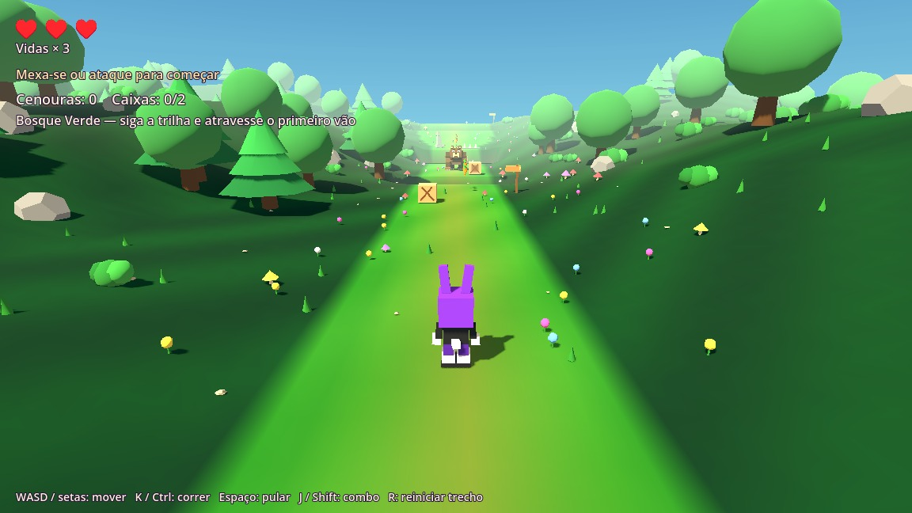

# Bunny Havoc — cenas reutilizáveis no Godot

[Baixar a pasta completa do projeto Godot](Bunny_Havoc_Godot_Cenas_Reutilizaveis.zip)

Extraia o ZIP em uma pasta nova, importe `project.godot` no Godot e pressione F5.
O projeto abre o trecho inicial do Bosque Verde, com os controles, combate,
saúde, sons e urso existentes. Na janela embutida, selecione Entrada.

Árvores e vegetação, cenouras, caixas, plataforma móvel, checkpoint e espinhos
agora são cenas reutilizáveis. A composição visual do bosque foi preservada.
Abra `ExemploNovaFase.tscn`, use Cena → Salvar Cena Como, arraste os arquivos
`.tscn` de `Cenas/` e pressione F6. Não precisa anexar scripts manualmente.

Leia [COMO_CRIAR_FASES.md](COMO_CRIAR_FASES.md), também incluído no ZIP.

Validação no Godot 4.6.3: 20 verificações da fase, 32 de combate e 10 do catálogo,
além de 5 conferências renderizadas. O ZIP final passou nos testes de importação,
abertura, manifesto, fase e catálogo. Godot 4.7.2 do usuário ainda requer
conferência local.

Esta é a pasta completa da etapa Godot atual. O restante das fases, a vila,
cutscenes e campanha ainda não foram portados; o projeto web original continua
preservado no repositório. A cena de exemplo serve para criação de fases.

