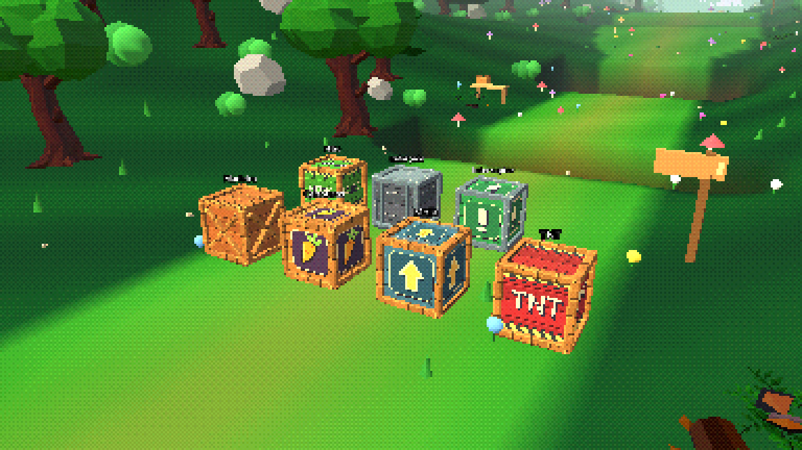
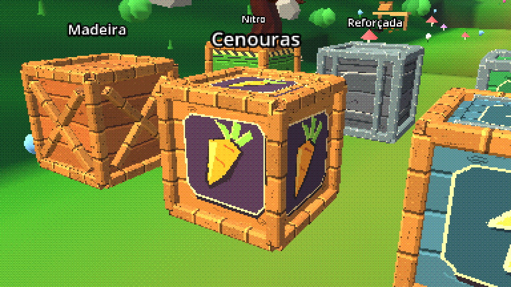

# Bunny Havoc — atualização 012 / Godot 4.7

Sete caixas renovadas: atlas pixelado original com tábuas, veios, símbolos,
metal escovado e desgaste. Vigas chanfradas, rebites, tampas e travessas.
Quiques com compressão e rebote, rachaduras na reforçada, perigo animado na
TNT/Nitro e interruptor com face acionada. Quebra solta tábuas texturizadas;
caixas de cenouras mostram duas cenouras em arco ao quicar.

Mantém regras, recompensas, posições, colisores e contagem de 14 caixas da 011.
Personagens, controles, áudio, cenário e cutscene preservados.

Feche o Godot e extraia o ZIP na pasta de project.godot do projeto completo
Godot 4.7 entregue anteriormente. Substitua arquivos e use F5. Inclui 008 a 011.
Este ZIP não é um projeto independente. F2 alterna o shader PSX enviado.

Testado no Godot 4.7.2 Compatibility: 17 verificações de arte/animação com
capturas nativas, 23 das regras de caixas, 22 da fase, 6 da travessia completa
com IA/dano ativos e 16 do PSX com renderização nativa. As imagens abaixo são
capturas dos modelos reais no cenário; a galeria existe só no teste.

