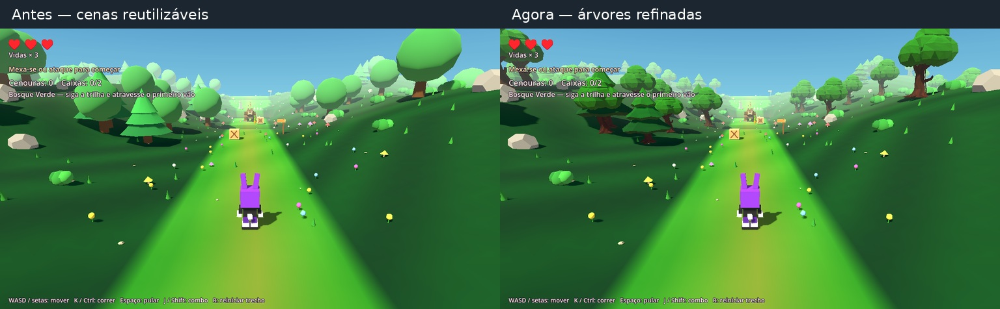
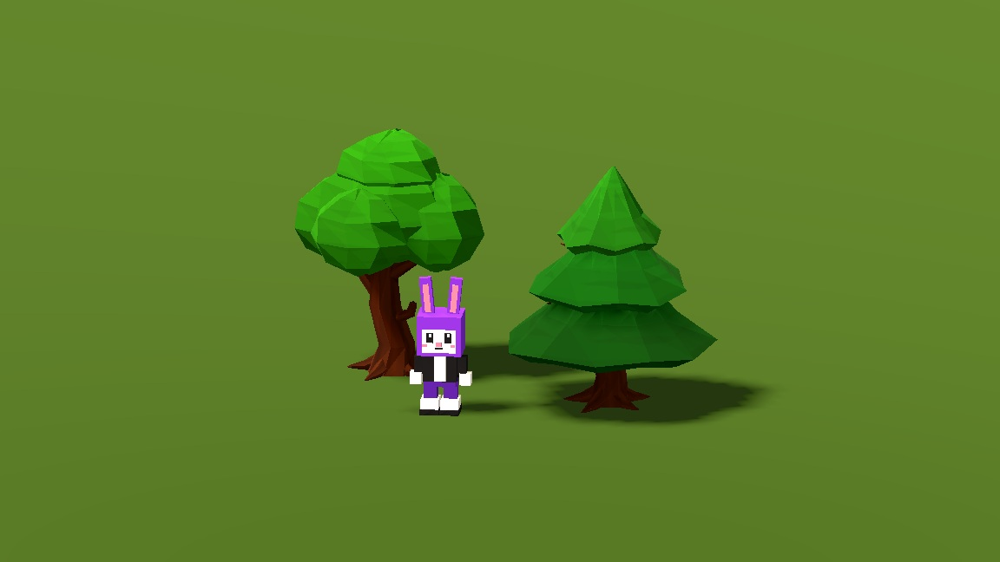

# Bunny Havoc — árvores refinadas no Godot

[Baixar o projeto Godot completo atualizado](Bunny_Havoc_Godot_Arvores_Detalhadas.zip)

Extraia o ZIP inteiro em uma pasta nova, importe `project.godot` no Godot,
aguarde a importação e pressione F5. Na janela incorporada, selecione Entrada.

A árvore de copa redonda e o pinheiro ganharam troncos irregulares, raízes,
galhos e copas com contornos recortados. Os modelos usam um atlas pequeno de
casca e folhas e continuam nas cenas reutilizáveis de `Cenas/Natureza/`.
As 100 árvores do trecho mantêm suas posições e escalas; terreno, outros
objetos, personagens, controles e mecânicas foram preservados.

O ZIP inclui toda a etapa Godot atual: trecho do Bosque Verde, arena anterior,
sistemas, áudios e exemplo para criar fases. O restante da campanha e a vila
ainda não foram portados da versão web.

Passaram 20 verificações da fase e 10 do catálogo no ZIP final, além de 5
conferências renderizadas. A geometria fora das árvores permaneceu idêntica,
e o agrupamento MultiMesh preserva as posições com erro zero. Agora são 22
grupos de vegetação, contra 26; os dois modelos têm 868 e 696 triângulos.
Não foi realizado benchmark de FPS. Engine de validação: Godot 4.6.3 Linux;
o 4.7.2 Windows do usuário ainda precisa de conferência local.

[Guia para criar fases](COMO_CRIAR_FASES.md)

