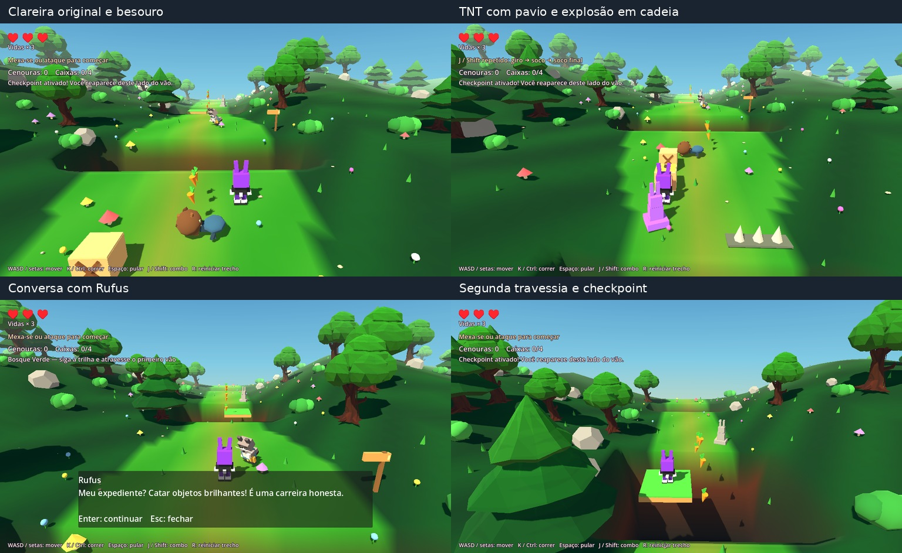

# Bunny Havoc — continuação do Bosque Verde no Godot

[Baixar o projeto Godot completo desta etapa](Bunny_Havoc_Godot_Bosque_Continuacao.zip)

Extraia o ZIP inteiro em uma pasta nova. No gerenciador do Godot, importe
`project.godot`, aguarde a importação e pressione F5. No jogo embutido, ative Entrada.
Não é necessário anexar scripts nem montar nós.

O percurso agora continua depois do primeiro checkpoint até o segundo:
clareira original, TNT com caixa vizinha, besouro patrulhando com sua bola,
Rufus com rotina/conversa e segunda plataforma móvel. O segundo checkpoint
passa a ser o ponto de retorno; voltar ao primeiro não apaga esse avanço.
O trecho inicial e as árvores refinadas foram preservados.

WASD/setas: mover; K/Ctrl: correr; Espaço: pular; J/Shift: combo.
Enter conversa com Rufus e avança as falas; Esc fecha a conversa.
R reinicia os dois trechos, coletas, inimigos, TNT e checkpoints.
A TNT acende com golpe/pisão e explode em 1,1 segundo: afaste-se!

São 4 caixas, 16 cenouras soltas, 2 plataformas e 2 checkpoints. O urso da
etapa anterior permanece como encontro de teste. TNT, besouro e Rufus também
são cenas reutilizáveis em `Cenas/`.

Passaram 40 verificações da fase e 12 do catálogo no ZIP final, incluindo
manifesto/importação/abertura, além de 8 conferências renderizadas. Comparação
individual/MultiMesh sem deslocamentos na extensão. 122 arquivos anteriores,
incluindo modelos, personagem, combate, áudio e cenário inicial, são idênticos.
Validação em Godot 4.6.3 Linux/Compatibility; o 4.7.2 Windows do usuário ainda
precisa de conferência local. Não é uma exportação Windows/Web pronta.

O ZIP contém toda a etapa Godot atual, a arena anterior e o exemplo para
criação de fases. O restante da fase, Vixxo/Nina e outros NPCs iniciais,
lagartos, cutscenes, vila, campanha e persistência ainda não foram portados.
O jogo web original continua preservado no repositório.

[Instruções](LEIA-ME.txt) · [Criar fases](COMO_CRIAR_FASES.md)

